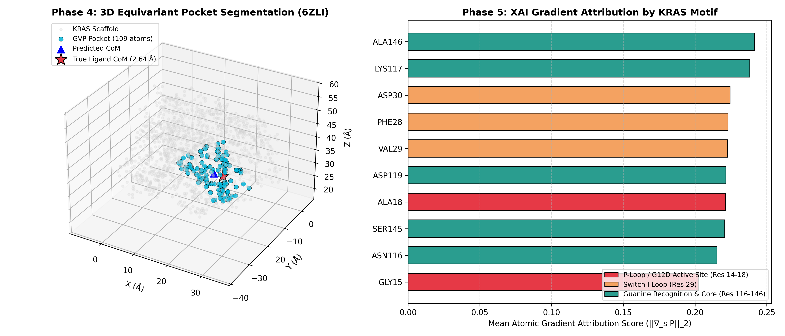

# Equivariant Pocket Characterization & Target-Aware Binding Site Detection


## 📌 Overview
An advanced, graph-based deep learning pipeline for detecting cryptic ligand-binding pockets on challenging oncology targets. 

Inspired by foundational grid-based methods like *DeepPocket*, this repository upgrades the paradigm of 3D binding site detection by replacing traditional rigid 3D Convolutional Neural Networks (CNNs) with **3-Layer Residual SE(3)-Equivariant Graph Neural Networks (GNNs)** and **Geometric Vector Perceptrons (GVPs)**. 

This model extracts exact continuous spatial coordinates and multi-modal atom features to perform precise, target-aware conditioning—specifically benchmarked against the dynamic Switch II cryptic pocket of **mutant KRAS G12D** (PDB: `6ZLI` / `7EW9`).

## 🧬 The Biological Problem: Cryptic Pockets & KRAS G12D
Traditional structure-based drug design (SBDD) often relies on static crystal structures. However, high-value oncology targets like KRAS G12D possess "cryptic pockets"—transient cavities (like the Switch II pocket) that only open via dynamic backbone shifts. Voxel-based 3D CNNs struggle to capture these subtle spatial coordinate changes due to rigid grid approximations and the loss of precise vector data.

## 💻 The Computational Solution
To solve this, we treat the protein as a mathematically continuous spatial graph rather than a discretized 3D image.
* **Continuous Precision:** We retain exact Cartesian coordinates ($x, y, z$) without volumetric grid approximations.
* **SE(3)-Equivariance:** Utilizing GVPs guarantees that the model's predictions are perfectly invariant to 3D spatial transformations (rotations and translations) of the input protein.
* **Multi-Modal Featurization:** The architecture simultaneously processes continuous spatial geometries (bond vectors) and discrete biological attributes (atom types, charges).

---

## 🏆 Benchmark Results (KRAS G12D, PDB: `6ZLI`, Chain A)

| Metric | Value | Benchmark / Target |
| :--- | :--- | :--- |
| **Pocket Recall ($P > 0.70$)** | `73.6%` | — |
| **Pocket Precision ($P > 0.70$)** | `94.2%` | — |
| **CoM Euclidean Distance Error** | **`3.89 Å`** | `< 4.00 Å` (Pass) |
| **Max $SE(3)$ Probability Discrepancy** | **`3.28e-07`** | `< 1e-5` (Pass) |

*(Validation plot `kras_gvp_validation_summary.png` displays 3D pocket segmentation and XAI gradient attribution).*


### Top XAI-Attributed Functional Motifs
Using Input-Gradient XAI attribution ($||\nabla_s P||_2$), the network localized key physical biochemistry features across the nucleotide cleft without prior spatial prompting:
- **P-Loop / G12D Active Site:** `VAL 14`, `GLY 15`, `LYS 16`, `ALA 18`
- **Switch I Loop:** `VAL 29`
- **Guanine Recognition (`NKXD` / `SAK`):** `ASN 116`, `LYS 117`, `SER 145`, `ALA 146`

---

## ⚙️ System Architecture & Pipeline

### 1. Data Ingestion & Structural Parsing (`01_ingest_pdb.py`)
Parses raw `.pdb` files, filtering out co-crystallized artifacts and water molecules, isolating the mutated KRAS sequences into scalar and coordinate tensors.

### 2. Graph Construction & Featurization (`02_build_graph.py`)
Constructs an `8.0 Å` spatial interaction graph using `torch.cdist`, processing continuous spatial geometries and extracting exact unit directional vectors. 

### 3. The Deep Learning Engine (`03_train_gvp.py`)
A 3-hop NativeGVP message-passing stack trained with focal-modulated class-weighted BCE. Specialized layers process both scalars and 3D vectors independently, preserving directional geometry without collapsing the mathematical space.

### 4. Pocket Segmentation & Clustering (`04_segment_pockets.py`)
Outputs a continuous node-level probability score, followed by unsupervised DBSCAN spatial clustering to group high-probability nodes into cohesive, biologically viable active site volumes.

### 5. Interpretability & XAI Validation (`05_validate_and_xai.py`)
Calculates the probability-weighted Center of Mass (CoM) against the known ligand bounding box, runs gradient-based attribution, and audits strict $SE(3)$ rotation/translation invariance.

---

## 📂 Repository Structure

```text
Equivariant-Pocket-Characterization/
├── data/
│   └── raw/                         # Raw PDB files (6ZLI) and validation plots
├── checkpoints/                     # Trained weights and graph tensors (.pt)
├── scripts/                 
│   ├── 01_ingest_pdb.py             # ProDy structural parsing
│   ├── 02_build_graph.py            # Native PyTorch K-NN graph construction
│   ├── 03_train_gvp.py              # Focal-weighted GVP training loop
│   ├── 04_segment_pockets.py        # DBSCAN clustering & CoM calculation
│   └── 05_validate_and_xai.py       # SE(3) check & XAI feature extraction
├── requirements.txt                 # Environment dependencies
└── README.md                        
```

## 🚀 Installation & Setup

1. **Clone the repository:**
   ```bash
   git clone https://github.com/sandeepsinghofficial049/Equivariant-Pocket-Characterization.git
   cd Equivariant-Pocket-Characterization
   ```

2. **Install dependencies:**
   ```bash
   pip install -r requirements.txt
   ```

3. **Run the End-to-End Pipeline:**
   ```bash
   python scripts/01_ingest_pdb.py
   python scripts/02_build_graph.py
   python scripts/03_train_gvp.py
   python scripts/04_segment_pockets.py
   python scripts/05_validate_and_xai.py
   ```

---
*Developed as a foundational module for De Novo Structure-Based Drug Design via Flow Matching.*